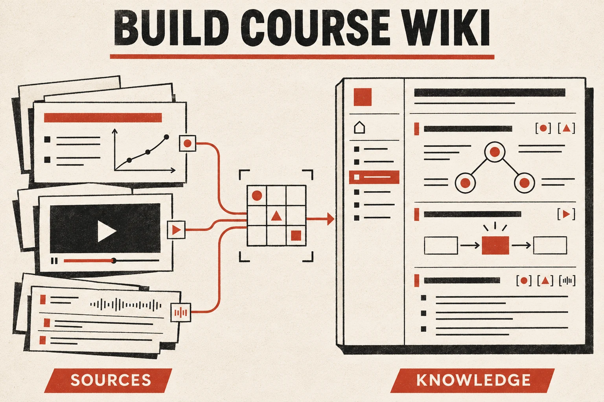

# Time-to-Time Agent Skills

A small collection of reusable agent workflows.

## Build Course Wiki



[**Build Course Wiki**](skills/build-course-wiki/) turns lecture slides, readings, and authentic video transcripts into a source-grounded self-learning wiki. It guides an agent through source verification, concise executive summaries, detailed slide notes, original concept diagrams, evidence-backed slide/video alignment, and accessible static-site delivery.

The workflow is course-, framework-, and host-independent. Missing transcripts stay visibly missing; approximate alignment is labeled; source coverage and validation are reported honestly. Public source availability is not treated as permission to republish full decks or transcripts.

- [Skill instructions](skills/build-course-wiki/SKILL.md)
- [Content and evidence contract](skills/build-course-wiki/references/content-contract.md)
- [Overview and background](https://gcgloven.github.io/knowledge/build-course-wiki/)

## Install

Review the skill before installation. It contains instructions and a reference document, not an executable site generator.

### Skills CLI

From your intended project directory:

```sh
npx skills add gcgloven/time-to-time-agent-skills --skill build-course-wiki
```

Choose the target agent in the interactive prompts. To target Codex explicitly:

```sh
npx skills add gcgloven/time-to-time-agent-skills --skill build-course-wiki -a codex
```

To inspect discovery without installing:

```sh
npx skills add gcgloven/time-to-time-agent-skills --list
```

The CLI currently requires Node.js 22.20 or later. Installation defaults to the current project; add `-g` only if you want a user-wide installation. These commands use the [official Skills CLI installation syntax](https://github.com/vercel-labs/skills/blob/main/docs/commands.md), checked on 2026-11-11. This is direct installation from GitHub, **not a claim that the skill is listed or approved in a marketplace**.

### Download without the CLI

1. Open this repository's **Code** menu and choose **Download ZIP**, then extract it. Alternatively, clone it with `git clone https://github.com/gcgloven/time-to-time-agent-skills.git`.
2. Copy the complete `skills/build-course-wiki` folder, including `references/` and `agents/`, into the skills directory supported by your agent. Consult its current documentation rather than copying only `SKILL.md`.
3. For a project-local Codex installation, the destination is `.agents/skills/build-course-wiki/` in that project. Do not overwrite an existing installation without reviewing or backing it up.
4. Open your agent in that project and ask it to use `build-course-wiki`. Follow your client's skill refresh instructions if it has not discovered the folder yet.

See the CLI's [supported agents and installation paths](https://github.com/vercel-labs/skills/blob/main/docs/agents.md) for other clients. A GitHub download does not automatically install a skill into a hosted ChatGPT account.

## Example request

> Use build-course-wiki to create a self-learning wiki from these lecture PDFs and official video links. Start with lectures 1–3. Include brief summaries, concept diagrams, slide-level notes, review questions, and a source coverage page. Use actual transcripts only; show any gaps. Prepare a reviewable preview before publishing.

Provide the course/version, source files or URLs, target audience, depth, and destination when known. PDF extraction, transcription, browsing, coding, and hosting tools depend on the agent environment and are not bundled here.

## Layout

```text
skills/
  build-course-wiki/
    SKILL.md
    agents/openai.yaml
    references/content-contract.md
```

The portable entry point follows the [Agent Skills format](https://agentskills.io/specification). The optional `agents/openai.yaml` supplies display metadata for clients that support it.

