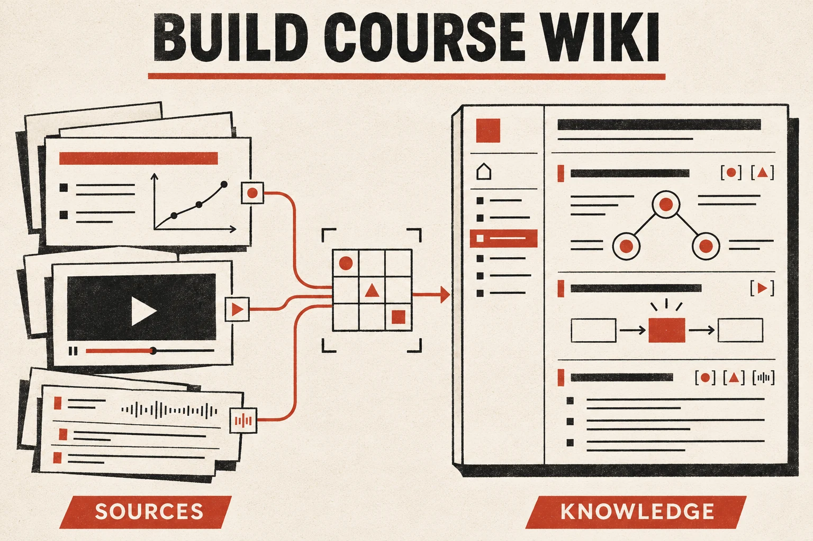
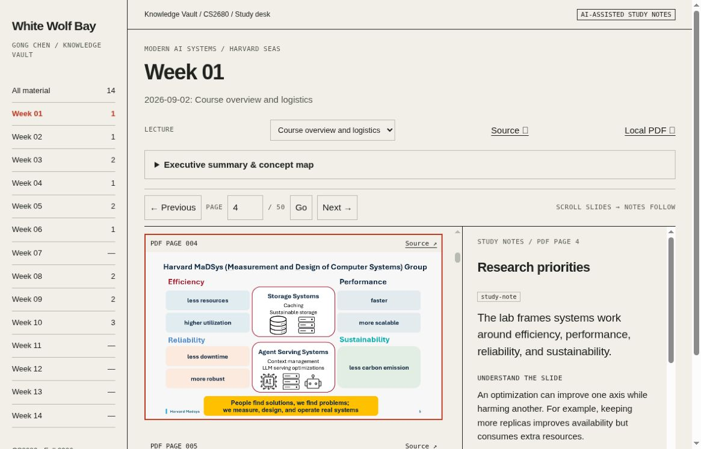

# Build Course Wiki

[← Skill catalog](../../README.md#skill-catalog)



Turn lecture slides, readings, and authentic video transcripts into a source-grounded wiki or curated learning webpage through the full pipeline:

1. Inventory, extract, and normalize the data with provenance.
2. Synthesize summaries, concepts, detailed notes, diagrams, and review material.
3. Define the information architecture, UI, content presentation, and interaction states.
4. Implement the responsive, accessible wiki or curated webpage.
5. Verify evidence, rendered pages, and interactions; deliver a reviewable result before any authorized publication.

For slide-based learning, define coordinated slide/notes navigation and add video alignment only when supported by evidence. Choose the layout and output format from the learning goal rather than forcing every source set into one template.

The workflow is course-, framework-, and host-independent. Missing transcripts stay visibly missing; approximate alignment is labeled; source coverage and validation are reported honestly. Public source availability is not permission to republish full decks or transcripts.

- [Skill instructions](SKILL.md)
- [Content and evidence contract](references/content-contract.md)
- [UI and presentation contract](references/ui-presentation-contract.md)
- [Overview and background](https://gcgloven.github.io/knowledge/build-course-wiki/)

## Install

Review the instructions first. This skill includes workflow instructions, executable extraction and validation helpers, an optional editable reader template, original sample data, and regression tests. It is not an automatic course crawler or a substitute for source review.

From your intended project directory:

```sh
npx skills add gcgloven/time-to-time-agent-skills --skill build-course-wiki
```

Choose the target agent in the prompts. For Codex explicitly:

```sh
npx skills add gcgloven/time-to-time-agent-skills --skill build-course-wiki -a codex
```

For manual installation, copy this complete folder, including `references/`, `scripts/`, `assets/`, and `agents/`, to your agent's skills directory. The project-local Codex destination is `.agents/skills/build-course-wiki/`. Do not overwrite an existing installation without review or backup.

See the [collection installation guide](../../README.md#install-a-skill) for runtime requirements, scope, discovery, and supported-client documentation.

## Example request

> Use build-course-wiki to create a self-learning wiki from these lecture PDFs and official video links. Start with lectures 1–3. Extract and synthesize the sources, define the UI and content presentation, then implement a responsive wiki with brief summaries, concept diagrams, coordinated slide/notes navigation, review questions, and a source coverage page. Use actual transcripts only; show any gaps. Prepare a reviewable preview before publishing.

Provide the course/version, source files or URLs, target audience, depth, and destination when known.

## Requirements and boundaries

- Python 3.10+ and the pinned `scripts/requirements.txt` dependency support the included PDF extractor. Caption parsing and structural validation use Python's standard library. Optional rasterization uses Poppler. Browser tests require Node.js, Playwright, and Chromium. Browsing, speech transcription, and hosting are environment-provided.
- Use actual accessible sources. If a transcript is unavailable, keep the notes slide-grounded and disclose the gap.
- Review source rights before reproducing slides, figures, or transcript excerpts.
- Building a preview does not authorize publishing it or changing its audience.
- Validate source coverage, links, accessibility, and the rendered result before delivery.

## Files

- `SKILL.md`: portable workflow instructions.
- `references/content-contract.md`: evidence schema and review cases.
- `agents/openai.yaml`: optional display metadata for compatible clients.
- `references/ui-presentation-contract.md`: UI definition, presentation patterns, and visual/interaction QA.
- `README.md`: this human-facing guide.

The illustration remains at its existing repository asset URL so older links continue to work; it is not required to run the skill.


## Reader screenshot



Captured from the [live CS2680 study reader](https://gcgloven.github.io/knowledge/cs2680-study/weeks/week-01.html#1_intro:4) on 2026-11-11. This is a separate, customized example, **not a screenshot of the bundled template** or evidence that its browser tests passed. The screenshot illustrates the side-by-side slide/notes experience; navigation and scroll behavior are defined in the [reader contract](references/scroll-reader-contract.md). Fonts, colors, components, layout, and framework can be redesigned to suit the user.

The visible slide is from the [original course deck, PDF page 4](https://cs2680.com/slides/1_intro.pdf#page=4); copyright remains with its authors. This screenshot is a UI reference, not a license to redistribute course materials. For a reusable, public-safe starting point, use the original synthetic demo below.

## Optional scroll-synchronized reader

Choose this variant when requested; do not force it on every wiki. Scrolling source slides updates corresponding notes, selection, navigation, and deep links. The HTML/CSS/JS is a functional reference that you can redesign to the user's taste or with another UI skill. The behavioral specification stays authoritative; fonts, colors, components, layout, and framework are not fixed.

- [Behavior and renderer specification](references/scroll-reader-contract.md)
- [Template schema, setup, tests, and limitations](references/reader-template.md)
- [Original runnable template](assets/reader-template/index.html)
- [Extraction dependencies and validation](references/extraction-and-validation.md)
- [Full synthetic worked example and deployment guidance](references/worked-example.md)

Generate a full local example, starting in this skill folder:

```sh
python -m pip install -r scripts/requirements.txt
python scripts/build_example.py /tmp/course-example-reader
python -m http.server 8000 --directory /tmp/course-example-reader
```

Open `http://localhost:8000/`. The example actually extracts generated PDF and VTT fixtures, validates provenance and locators, then adapts authored synthesis to the reader. All demo content is original and synthetic. It does not contain a real course transcript or claim video synchronization. Publishing remains a separate authorized action.

Run `python scripts/test_pipeline.py` and the browser commands in the template reference. PDF.js, OCR, audio transcription, multi-lecture switching, and live video synchronization are not bundled implementations. Keep those limits visible and test your final customized deployment.

## Validation status

On 2026-11-11, eight Python regression tests, the synthetic end-to-end build, optional Poppler page rendering, JavaScript syntax checks, skill validation, and relative documentation links passed. The browser regression suite is included but **was not executed successfully in the authoring environment**: Chromium startup was restricted and the separate browser could not reach the local preview server. Desktop/mobile visual behavior and scroll synchronization therefore still require running the documented browser checks. No live demo deployment is claimed.
